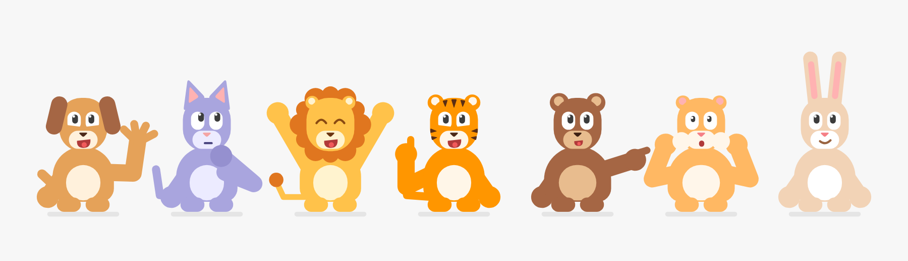

<div align="center">

# Roundimals

**A Claude skill that draws cute, flat, rounded animal mascots for your apps: quiz hosts, game guides and chat avatars.**

   



</div>

> **Work in progress.** This is an early version (0.1.0). Shapes, poses and rules still change with every push until the first release. Feedback is welcome.

## Overview

Seven animals share one body built from three rounded shapes: **dog, cat, lion, tiger, bear, hamster and rabbit**. Each one gets eight poses for typical app moments and seven avatar expressions for chats:

- **Poses:** neutral, asking, explaining, paw up, cheering, sad, waving, surprised
- **Avatar expressions:** neutral, happy, laugh, thinking, surprised, sad, talking
- **Colors:** natural by default, or any fantasy color from a single value ("a blue lion"). Gray is never used.
- **Clothes:** optional shirt or hoodie, off by default

Everything comes out as plain SVG, ready for web, iOS or Android apps.

## Why use it?

Agents draw cartoon animals inconsistently: each one in a different style, with stick arms, whiskers and outlines, and teeth that vanish on a light muzzle. This skill gives Claude one shared body with fixed proportions, a short list of signature shapes for each animal, and a table of mistakes already made with the fix for each. The result is seven animals that look drawn by the same hand.

## Requirements

- Claude Code, or the Claude apps (web or desktop) with Skills enabled
- Optional: Node.js 18+ to run the drawing kit locally (no dependencies)

## Install

- **Claude Code:** copy the `roundimals` folder into `~/.claude/skills/` (every project) or into `.claude/skills/` inside one project.
- **Claude apps (web or desktop):** zip the `roundimals` folder (or download `roundimals.zip` from a release) and upload it in Settings, under Capabilities, Skills.

Claude loads the skill on its own when you ask for a flat animal mascot. You can also name it: "use the roundimals skill".

## Usage

Ask Claude, for example:

- "Draw an SVG of a tiger asking a quiz question, roundimals style."
- "Make a round chat avatar of a happy hamster on a light blue background."
- "I need a blue lion cheering for my language app's level-complete screen, as React Native SVG."
- "Give me the rabbit in all eight poses in a green hoodie."
- "Review this mascot and tell me what breaks the roundimals style."

Or render directly with the kit:

```bash
cd roundimals
node reference/render.mjs lion cheering > lion.svg
node reference/render.mjs cat waving --color pink > cat.svg
node reference/render.mjs bear explaining --clothes hoodie:#1CB0F6 > bear.svg
node reference/render.mjs hamster avatar:happy --round --background "#DDF4FF" --size 128 > avatar.svg
node reference/render-sheet.mjs out   # contact sheet of everything: out/sheet.svg
```

## Configuration

| Option (render.mjs) | Meaning | Example |
|---|---|---|
| `<animal>` | dog, cat, lion, tiger, bear, hamster, rabbit | `lion` |
| `<pose>` or `avatar:<expression>` | one of the poses, or an avatar expression | `asking`, `avatar:talking` |
| `--color` | fantasy color: blue, purple, pink, green, red, yellow or any hex | `--color "#1CB0F6"` |
| `--clothes` | `shirt` or `hoodie`, then a color | `--clothes shirt:#FF4B4B` |
| `--size` | output width in px (default 400) | `--size 128` |
| `--background` | fill behind the animal | `--background "#F7F7F7"` |
| `--round` | clip to a circle (chat avatars) | `--round` |

## Reference

- **[SKILL.md](./roundimals/SKILL.md)**: the rules, proportions, the seven animals, poses, colors, a checklist and the mistakes to avoid.
- **[reference/measurements.md](./roundimals/reference/measurements.md)**: every number of the shared body and the reasoning behind it.
- **[reference/kit.mjs](./roundimals/reference/kit.mjs)**: the drawing kit (Node 18+, no dependencies). Port the geometry to React Native SVG, Skia or canvas unchanged.

## Note

The animals are original characters. The skill tells Claude never to imitate an existing brand's mascot or logo, and it deliberately has no birds.

## License

[MIT](./LICENSE)

## Changelog

See [CHANGELOG.md](./CHANGELOG.md)
